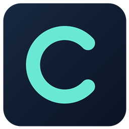
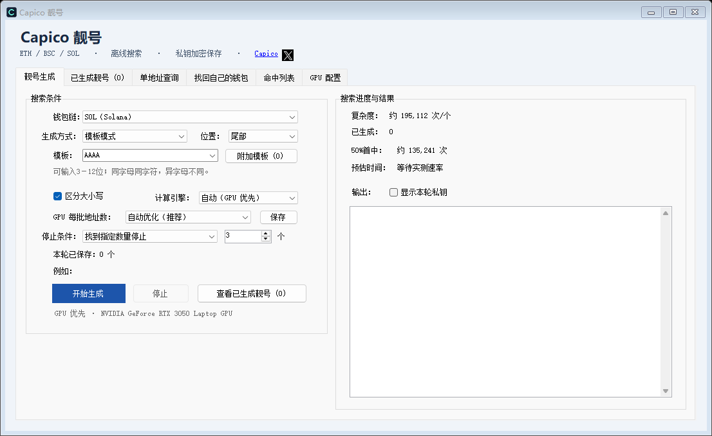
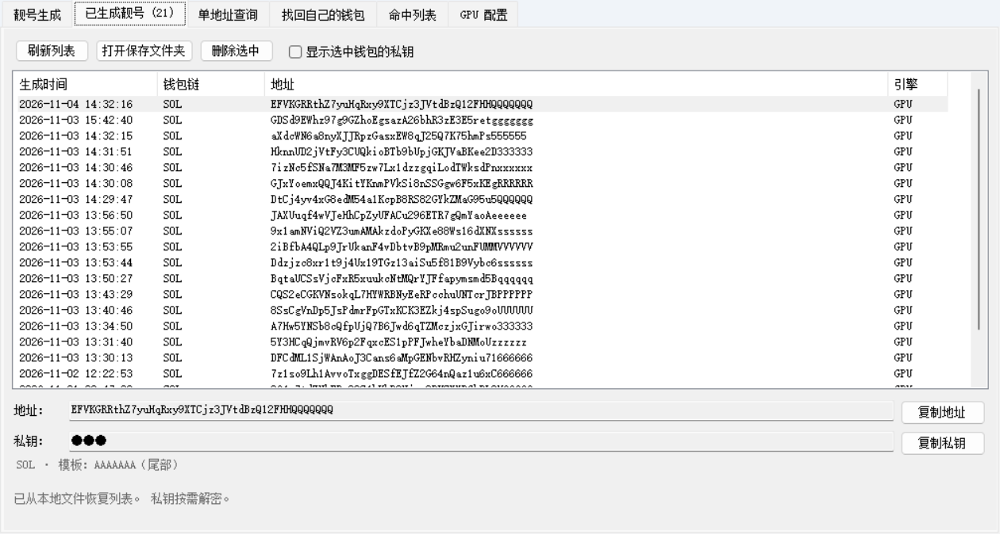
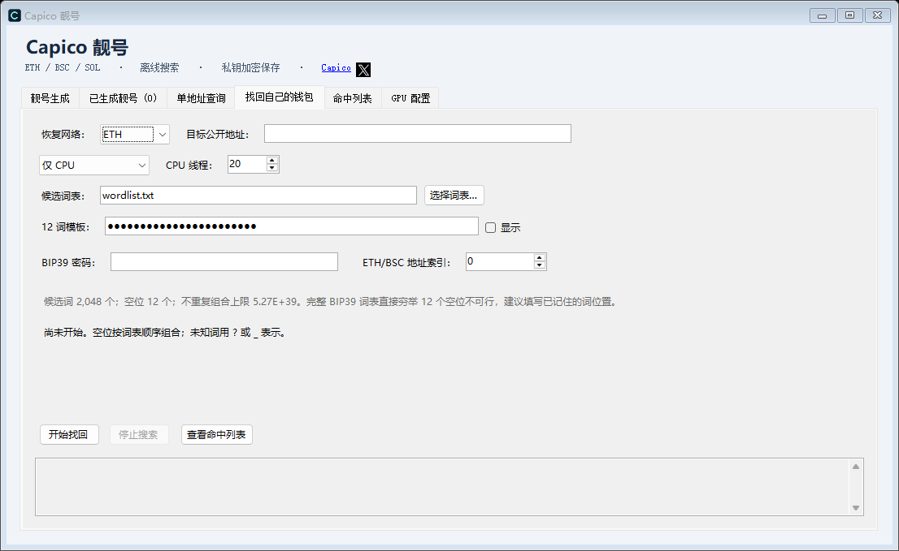

<p align="center">
  
</p>

# Capico 靓号 · CapicoVanity

**在自己的电脑上，生成自己喜欢的钱包地址。**

支持 **ETH / BSC / Solana** 的 Windows 靓号生成工具。前后缀、连号、顺子和组合模板均可选择，兼容 GPU 优先加速，没有兼容显卡也能使用多线程 CPU。

由 [Capico · @NanaWiti](https://x.com/NanaWiti) 维护 · Windows x64 · 本地生成 · 私钥加密保存

## 生成界面



选择链、模板和停止条件，点击「开始生成」。GPU 批次可自动优化，搜索时按实测速率显示预估时间。

## 生成结果



维护者提供的实际结果截图，展示多种 SOL 尾部重复靓号，列表包含 21 条记录。截图中的私钥处于隐藏状态；图片仅展示生成结果，不代表收益、余额或生成速度。

## 能做什么

- **三链靓号**：ETH / BSC 共用 EVM 地址体系，Solana 使用独立地址格式。
- **前后缀与模板**：54 个内置模板，可输入 3–12 位模板，并添加最多 5 个附加模板。`AAAA` 表示四位相同，`ABCDE` 表示五位递增顺子，`AABBAABB` 表示重复组合。
- **顺手收集更多结果**：选择八位相同时，更长的连续重复也会命中；附加模板可同时收集其他规律，按成功保存的钱包数量计数。
- **自动选择计算引擎**：兼容 GPU 优先，无可用设备或 GPU 无法运行时回退 CPU，也能手动选择仅 CPU。GPU 批次支持自动优化。
- **灵活停止**：找到一个、找到指定数量、持续生成直到手动停止。
- **加密保存**：靓号私钥以 Windows DPAPI 当前用户模式保存，结果列表默认隐藏私钥。
- **自己的钱包恢复**：按已知地址和助记词线索在本机搜索，命中列表与靓号结果分开。恢复结果只保留在本次会话。
- **公开地址查询**：通过公共 RPC 查询 ETH、BNB、SOL 原生币余额，无需币安账户或 API Key。

## 下载与开始使用

发布后在本仓库的 **Releases** 页面选择 Windows x64 包，下载 EXE 或包含 EXE 的 ZIP。无需安装开发工具，也不需要管理员权限。

| 版本 | 适合谁 | 计算方式 |
| --- | --- | --- |
| 普通版 `CapicoVanity-Win64-*.exe` | 没有兼容 NVIDIA CUDA 显卡，或主要生成 SOL | EVM CPU；SOL CPU / OpenCL |
| CUDA 版 `CapicoVanity-Win64-CUDA-*.exe` | 希望使用兼容 NVIDIA 显卡生成 EVM 靓号 | 在普通版基础上增加 EVM CUDA |

1. 双击 EXE。需要 **.NET Framework 4.7.2 或更高版本**；缺少时启动器可打开微软官方下载页面，安装运行时后重新启动程序。
2. 打开「靓号生成」，选择 EVM 或 SOL，设置前后缀或模板。第一次建议使用较短条件。
3. 保持「自动（GPU 优先）」和自动优化，选择停止条件，开始生成。
4. 在「已生成靓号」查看结果。需要导入钱包时，明确确认后复制所需私钥，并在可信环境中操作。

下载后可将 EXE 的 SHA-256 与同名 `.sha256.txt` 文件核对。完整版本说明见 [RELEASE-NOTES.md](RELEASE-NOTES.md)。

## 显卡与速度

EVM CUDA 需要兼容的 NVIDIA 显卡、计算能力 7.5 或以上及相应驱动。SOL GPU 和钱包恢复 GPU 使用 OpenCL，需要可运行本程序内核的显卡与驱动。CPU 模式不依赖 CUDA 或 OpenCL。

生成速度取决于硬件、链、模板和大小写设置，不能保证每台电脑达到相同速度。更长的重复约束通常需要更多尝试；预估时间来自实测速率和概率，不是倒计时，也不保证在该时间内命中。

<details>
<summary>查看自己的钱包恢复界面</summary>



只用于你有权访问的钱包。默认自动选择计算引擎，也可手动使用 CPU；开始搜索后助记词输入恢复隐藏。恢复结果需要在结束会话前自行妥善备份。

</details>

## 钱包与数据安全

靓号生成和自己的钱包恢复在本机计算，不依赖币安 API。手动查询余额时，公开地址会发送到所配置的 RPC 节点；点击 X 链接或运行时下载提示会打开浏览器。

私钥加密文件依赖原 Windows 用户配置，**不能作为跨电脑备份**。换电脑或重装前，请在原账户中完成自己的加密备份。复制后的私钥和助记词仍可能被其他程序读取；不要把钱包秘密发到 Issue、截图或聊天中。程序会校验生成结果，但本地测试不等于第三方安全认证。

为兼容改名前版本，分享版继续使用 `%LOCALAPPDATA%\NanaVanity\Data` 保存钱包与设置；程序缓存位于 `%LOCALAPPDATA%\NanaVanity\Programs`。启动器逐一核对程序文件，篡改、缺失或额外文件会阻止启动。原有数据不会因产品改名自动搬移或删除。

## 从源码构建

Windows x64、PowerShell 5.1 和 .NET Framework 4.7.2 或更高版本：

```powershell
powershell -NoProfile -ExecutionPolicy Bypass -File packaging/Build-Share.ps1
```

首次构建下载锁定版本的依赖与工具，并校验压缩包 SHA-256。默认构建普通版；CUDA 版还需取得校验匹配的后端并传入 `-IncludeCuda`。构建步骤、离线缓存和验证方法见 [BUILDING.md](BUILDING.md)。
